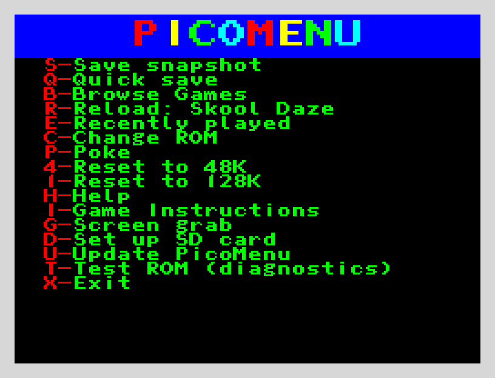
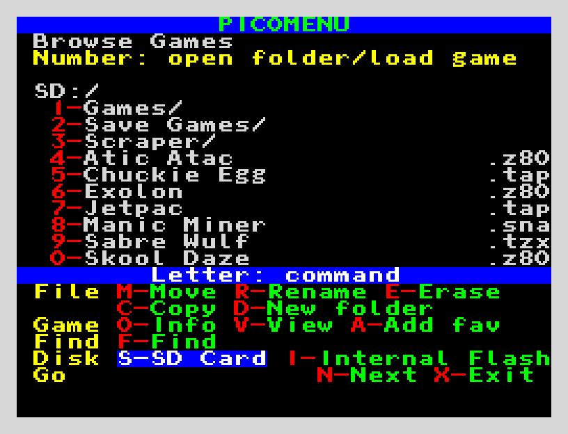
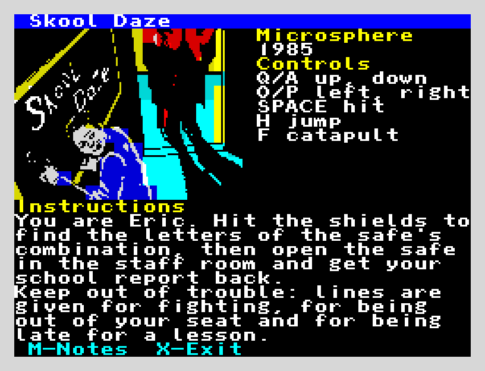

# PicoMenu

PicoMenu is a fork of [picoFace](https://github.com/) by Brian Apps: the hardware and the original firmware are his, and the menu and file features here are added on top. It keeps the GPL v3 licence (see `LICENSE` and `THIRD-PARTY-NOTICES.txt`). The picoFace is an inexpensive device for the ZX Spectrum that uses a Raspberry Pi Pico to provide Multiface style functionality.

Picomenu has been built using Brian Apps original code, an AI (Claude) has then developed on this with my input. My main input to this project was to decide on functionality, layout, feature set and testing.

Picomenu has been developed for and tested on a Spectrum +2 (Grey). It should work fine on a standard 48k or 128k model, although I have not been able to test. It will not work on +2A/+3, +2B, and +3B.

[](https://www.youtube.com/watch?v=EOnCzTOS64U)

Picomenu can be used to:
* Replace the internal ROM with another image, optionally making it writable.
* Load and save snapshots, 48K and 128K, as `.sna`, `.z80` and `.szx`; load `.tap` and `.tzx` tapes.
* Convert a `.tap` or `.tzx` into a `.z80` snapshot on the Pico itself, for turbo and protected loaders too (Speedlock and others): C on a tape's information (V in Browse Games), then A (Auto), 4 (48K) or 1 (128K). The tape is loaded by its own loader on a Spectrum the Pico emulates, using `48.rom` and `128.rom` (or `128-0.rom` and `128-1.rom`) that you put in the root of the flash, the SD card's `ROMS` folder, or the root of the card. While it converts, the tape's loading screen is saved by itself in `/Scraper/Screen Grabs` as `<game> Loading Screen.scr`, and S saves the screen at any time (also as `<game> Loading Screen<n>.scr`, the lowest number free).
* Multi-load 48K tapes (`.tap` and `.tzx` games that load their levels with the ROM's loader, such as Out Run and Gauntlet) play through a ROM trap: each later level loads at once from the tape file, found by name or in order as the game asks. **T** in Browse Games puts a tape in without a reset for the Spectrum's own loading (the 128's Tape Loader, `LOAD ""`), for 128K tapes. **V - Virtual Tape Player** on the NMI menu lists the tape's blocks, moves the tape to any of them (1-0), rewinds it (R) or ejects it (E); **W** there records a new tape: each SAVE goes straight into `/Recordings/<name>.tap` on the SD card (a new file each time, never over another). A tape is ejected by itself before it (or its folder) is erased, moved or renamed, and a snapshot saved while a tape plays remembers where the tape was (in `/Tape Files`), so loading it carries on with the next level; the note follows the tape when the tape (or its folder) is renamed, moved or put in the Waste Bin. A game that loads its levels with its own copy of the ROM's loader (Out Run's Speedlock releases) is found and patched to load from the tape file too: when a tape is put in with T, when a snapshot carries on with its tape, and in each block the trap loads (`level_loaders` in Picomenu.ini). Levels loaded by other turbo or protected loaders are not trapped (convert those instead).
* Controls and instructions for each game from a text file `Instructions.txt` in the folder `Scraper` on the SD card (or in the root, if there is none there): shown beside a small copy of the game's screen (V in Browse Games, where D deletes a screen grab) and from the menu with I (Game Instructions) after the game has loaded, with the game's screen grabs as V shows them (its screen as it was, if it has none) (see `Docs/Instructions-example.txt`).
* Save or grab the screen from the button without the menu: hold it a second for the save screen (the game's save slots, or the Save snapshot screen), press it twice for the screen grab question; either goes straight back to the game (`save_press` in Picomenu.ini swaps them).
* Each game's information can also show its software house and year, and your own notes on the game (M while the information shows, E to edit them; kept in a `Game Notes` folder that you make in the root of the SD card).
* A list of the last 10 games played (E on the menu), kept after power off; 1 to 9 and 0 load one, V then a number shows its picture and instructions.
* A double press of the button (or a hold, with `save_press = double`) saves the running game's screen (`.scr`) in `/Scraper/Screen Grabs` on the SD card, asking its category: `<game> Loading Screen.scr`, `<game> Menu Screen.scr`, `<game> Game Screen.scr`, `<game> Ending Screen.scr` (then `...1.scr`, `...2.scr`, the lowest number free), or Standard Screen Number, `<game>.scr`, `<game>1.scr` ...; then the game carries on. V in Browse Games (on a `.tap`, `.tzx`, `.sna`, `.z80` or `.szx`) cycles through a game's pictures category by category in the order of the `[Screen grab order]` part of `Picomenu.ini` (or, without one, the older `/Scraper/Screen Grabs/order.txt`), and by number in each; the screen in the game's own file (a snapshot's, a tape's loading screen) is the category From File. A category the order file leaves out (or comments out with `#`) is not shown.
* The SD card shows up as a USB drive on a PC when the Pico is plugged in with the Spectrum off (copy files without taking the card out; eject before unplugging).
* Browse the SD card and the internal flash (both with folders, search, move files and folders, copy files and folders (a folder copy stays on one drive; the SD card and the flash are not mixed), copy files between the drives, rename files and folders, erase files and folders): preview a game's screen, show file sizes and which machine (48 or 128) each snapshot needs.
* Reload the last game with one key.
* Autosave: with `autosave` set (20, 40 or 60 seconds), a game loaded from the menu asks "Autosave this game?"; with Y a snapshot is saved every so many seconds into `/Autosave/<game>`, and A on the menu goes back to one of the last six, moves one to a save slot, or clears them.
* Apply pokes to loaded games, typed in or from a `.pok` file.
* Reset into 48K or 128K from the menu.
* Update PicoMenu's own firmware from a `.uf2` in the root of the SD card (T-Tools then U on the menu; if it fails, BOOTSEL still works).
* on-screen help



The NMI button (SW1):
| Press | Does |
|---|---|
| Short | Opens the NMI menu |
| Held 1 second (let go before 3 seconds) | **Save**: brings up the Save snapshot screen: where the game can be saved. Saving, or X/BREAK, takes you back to the game |
| Double press | **Screen grab**: takes a screen grab - this can be saved with the categories listed on the screen. Choosing a catagory or pressing BREAK takes you back to the game |
| Held 3 seconds | Resets into the Spectrum's own ROM |

### The NMI menu

| Key | Does |
|---|---|
| B | Browse Games (T puts a tape in for the Spectrum's own LOAD; with the Pico W firmware it asks `Trap (T) or Bluetooth (B)` first; O for info: Type, Size and Mode columns; H-Hide/Unhide hides a file or folder or shows it again (the SD card's hidden attribute, as Windows sets it; a littlefs attribute on the flash); L-All also lists the hidden ones, dimmed, and those always hidden because they can't be loaded: `Poke List`, `Tape Files`, `.scr` files and `.txt` files: a `.txt`'s number shows it a page at a time, and E edits it on the SD card, up to 3 KB with lines of 30 letters) |
| S | Save slots: nine saves of the game being played in `/Save Games/<game>` on the SD card (1-9 save, L label, V view, E erase); S there is the Save snapshot screen (type auto, .sna, .z80, .szx, same). On the Save snapshot screen a name already used by a snapshot of any type (`.sna`, `.z80`, `.szx`) asks to overwrite it first |
| R | Reload last game (shows its name, scrolling a long one; remembered after power off). A game with save slots asks which to carry on from, as in Browse Games; a save (anything in `/Save Games`, a slot among them) reloads as it is. A slot shows its game's name first: `Reload: Alpha Slot 1 - zone` |
| V | Virtual Tape Player: the blocks of the tape being played; 1-0 move to one, R rewind, **L label a line** (up to 16 letters, shown in yellow in place of the block's kind, kept in `/Tape Files/<tape>.labels` and following the tape when it is renamed or moved), E eject (or stop recording), W record a new tape into `/Recordings` |
| A | Autosave: the game's last six autosaves, newest first by their age in the game; a number selects one and carries on from it (the newer ones go), V shows one's screen, M moves one to a save slot (asking before going over a used one; the slot keeps its label), C clears the game's autosaves (after Y), O turns autosave on or off for the game being played, BREAK goes back |
| C | Change ROM: the `.rom` files in the root of the internal flash, or (2 - Show SD card /ROMS) those in the SD card's `ROMS` folder; 1 - Internal Rom goes back to the Spectrum's own ROM |
| P | Poke (L for the game's `.pok` list) |
| 4 / 1 | Reset into 48K / 128K |
| O | Options: the settings of `Picomenu.ini` on one page (Q/A move, C changes to the next choice; start_folder: the folder last browsed or /) and the screen grab order on another (N; U/D move a kind, H hides or shows it). Leaving after a change asks to save (Y), forget (N) or stay (BREAK); only the changed values are written, the file's notes stay. **D** shows the Diagnostics page (firmware, flash, SD card, the last error, where Picomenu.ini was read from) |
| T | Tools (each goes back to Tools when done; X there goes back to the menu): |
| &nbsp;&nbsp;T-T | Test ROM: choose zx-diagnostics (`testrom.rom`) or DiagROM (`DiagROM.rom`), kept in the root of the flash or the SD card's `ROMS` folder, and reset into it |
| &nbsp;&nbsp;T-D | Set up SD card: makes `Scraper` (with an example `Instructions.txt`), `Scraper/Screen Grabs`, `Picomenu.ini` (the settings, all at their defaults), `Game Notes`, `Save Games`, `Favourites`, `Poke List`, `Tape Files`, `Recordings`, `Waste Bin` (hidden), `ROMS` (hidden: ROM files) on a new card; replaces nothing |
| &nbsp;&nbsp;T-U | Update PicoMenu from a `.uf2` file in the root of the SD card (listed nowhere else) |
| &nbsp;&nbsp;T-W | Waste Bin: Browse Games in `/Waste Bin` (hidden, on the SD card), where erased files and folders go; erasing there is for good, B empties it (after Y) |
| &nbsp;&nbsp;T-C | Batch convert: choose a folder on the SD card (1-0 open, U up, N/P page). C converts each `.tap` and `.tzx` in it (not in folders below) as C - Convert does with Auto, into `Converted/` inside that folder. A tape whose `.z80` is already there is skipped, so running it again after BREAK carries on; `Converted/Batch convert.txt` lists what was saved and what did not load (and why), and a summary shows at the end. **T** does the opposite: each `.z80` in the folder becomes a `.tap` in `Tapes/` there, for loading on a real Spectrum with LOAD "" at the normal speed (a BASIC line, a 1 KB loader, then the memory; runs of one byte are filled in, not loaded; a 48K game takes 4-5 minutes, a 128K one, which needs a 128K Spectrum, up to 12). See `tools/z80tap` |
| &nbsp;&nbsp;T-F | File transfer (WiFi): on a Pico W with the Pico W firmware, joins the network named in Picomenu.ini's `[WiFi]` (or O - Options, W) and shows an address (`http://picomenu.local`, or the number, `http://192.168.1.57`) to open in a browser on a PC or phone, to browse the SD card, upload files (choose them, or drop them on the page) and download, rename, erase (to the Waste Bin) or make folders; the Spectrum waits on this screen, BREAK stops it (see [File transfer over WiFi](#file-transfer-over-wifi-pico-w)) |
| &nbsp;&nbsp;T-B | Bluetooth tape: on a Pico W with the Pico W firmware, plays the tape put in with T as sound to a Bluetooth receiver wired to the Spectrum's EAR socket, in real time, as a phone's tape app does, so the game's own loader loads it (turbo and protected loaders too); S searches, 1-8 pairs, P plays, T opens the tape player (see [Bluetooth tape](#bluetooth-tape-pico-w)) |
| X | Exit |


## Save slots
S on the menu shows nine slots for the game being played, kept on the SD card in `/Save Games/<game>` as `Slot 1.z80`, `Slot 2 - Zone 3.sna` and so on (the type follows `save_type`; auto is .sna for 48K and .z80 for 128K). A number saves to a slot (one already used asks first); L labels a slot (an empty one is saved there with the label); V shows a slot's screen; E erases one (to the Waste Bin); S opens the Save snapshot screen as before. The slot used last is marked. Holding the button a second opens the slots straight from the game, and saving one goes straight back to it. Loading a game that has slots (from Browse Games or with R - Reload) asks: 1-9 carries on from a slot, 0 starts the game itself, V shows a slot's screen, E erases a slot (after Y, to the Waste Bin), BREAK goes back to the list (or the menu). A slot keeps a tape position (multi-load games) like any save. The game is known by its name (without ` Save Game`), so a slot loaded is still that game's. Without an SD card S is the Save snapshot screen.

## Autosave
Set `autosave` in Picomenu.ini or O - Options to 20, 40 or 60 (seconds; `off` is the default). Each game then loaded from the menu (Browse Games, R - Reload, E - Recently played, a save slot) asks **Autosave this game?**: Y autosaves it, N plays it without. Resets (4 and 1 on the menu) and test ROMs don't ask. With it on, PicoMenu saves a snapshot of the game every 20, 40 or 60 seconds of play (time in the menu is not counted) and keeps the last six in `/Autosave/<game>` on the SD card (`Autosave 1.sna` ... `Autosave 6.sna`, or `.z80` for a 128K game; the game is named as its save slots are), the oldest written over.

**A** on the menu lists them, `1 0 seconds ago`, `2 20 seconds ago` ..., and a number selects one and carries on from it, tape position and all; the newer ones are dropped, and autosaving goes on from there. V shows an autosave's screen. **M** moves one to a save slot of the game (`/Save Games/<game>/Slot 3.sna` and so on, as S saves them; a slot in use asks first, and keeps its label). **C** erases the game's autosaves (after Y), and its folder when that is empty. **O** turns autosave on for the game being played even if it was answered N (or `autosave` is off: then every 20 seconds), or off again. An autosave can also be loaded from Browse Games like any snapshot; it is still known as its game's.

Each autosave stops the game while its memory is copied out: about 0.2 seconds for a 48K game and about 0.6 seconds for a 128K one (measured on the simulator at 3.5 MHz; the SD card is written after the game carries on). The game and its sound pause for that moment. Autosave needs the SD card, and stops at a reset, at 4 or 1 on the menu, and when another game is loaded (the files stay until C clears them, or the game's next autosaves go over them).

## File transfer over WiFi (Pico W)
With a **Pico W** in the Picoface and the **Pico W firmware** (`picomenu-Rev2.4.0-...-W.uf2`) on it, **T-F File transfer (WiFi)** puts the SD card on a web page. First give it the network's name and password: on the Spectrum in **O - Options, W** (the WiFi page: ENTER on a line, type it with CAPS SHIFT for capitals, ENTER; the passwords show as `*`), or in `Picomenu.ini` on the card:

```
[WiFi]
ssid = MyNetwork
password = my wifi password
web_password = something
```

(`web_password` is optional: with it, the browser asks for it before showing anything, with any user name.) T-F joins the network and shows the address to open in a browser on a PC, tablet or phone on the same network: **`http://picomenu/`**, **`http://picomenu.local`** (Windows 10 and later, macOS, iPhone and iPad, Linux, newer Android), or the number it shows, such as `http://192.168.1.57`, which always works. The name is answered by the Pico itself (mDNS and NetBIOS), so nothing needs setting up on the router. The page is in the Spectrum menu's own font. It lists the card's folders; click a file to download it, use **Upload files** or drop files on the page to put them in the folder shown (one of the same name asks before it is replaced), and **Rename**, **Erase** (to the Waste Bin, as E in Browse Games, and tape notes follow) and **New folder** work as in Browse Games. The Spectrum waits on the T-F screen, which counts what was sent and received; BREAK stops it, switches the WiFi off and goes back to Tools. Nothing of the WiFi runs at any other time.

The Pico W firmware is its own `.uf2`: it is about 620 KB (the WiFi chip's own firmware is most of it, then the Bluetooth), so its internal flash storage is 1400 KB, not 1800 KB. Putting it on a Picoface that had the standard firmware (or the other way round) with BOOTSEL **clears the internal flash** (its files, ROMs, the recently played list): copy anything you want from it to the SD card first. Update PicoMenu (T-U) only takes the same kind: the Pico W firmware on a Pico W, the standard one on a Pico. The standard firmware should also run on a Pico W (without T-F). The cyw43 WiFi driver and BTstack (the Bluetooth) in the Pico W firmware are not open source; the additional permission in LICENSE (below) lets the Pico W `.uf2` be passed on with the rest, and THIRD-PARTY-NOTICES.txt says what their own licences allow.

## Bluetooth tape (Pico W)
With the Pico W firmware, **T-B Bluetooth tape** sends a tape to a Bluetooth receiver wired to the Spectrum's EAR socket (the kind of Bluetooth mod a phone plays tapes to), in real time. PicoMenu takes the phone's place: it makes the tape's sound from the `.tap` or `.tzx` itself and the Spectrum's own loader loads it, so turbo loaders (Speedlock, Power-Load and the like) work as they do from a phone.
- **Pairing, once:** disconnect the phone from the receiver (it takes one at a time) and make it ready to pair (usually its light flashing). On the T-B screen, **S** searches for about 10 seconds and lists what it finds; **1-8** pairs with one (no PIN, or 0000). It is remembered: next time T-B connects to it by itself (**C** to connect again, **F** to forget it).
- **Playing:** put the tape in with **T** in Browse Games, open T-B, and once it says `On <receiver>` leave the menu (BREAK, then X): the tape is now the Bluetooth's. Type `LOAD ""` (or use the 128's Tape Loader) and the tape starts by itself, as a deck would be started. **P** on T-B plays it at once instead, after a second's silence. It goes on from the block the tape trap had got to.
- **Straight from Browse Games:** with the Pico W firmware, **T** on a tape then asks `Tape: Trap (T) or Bluetooth (B)`. **T** puts it in for the tape trap, which loads at once, as before; **B** puts it in for the Bluetooth: it switches on and connects to the receiver paired last as the menu goes, and `LOAD ""` plays it. BREAK puts nothing in. (The standard firmware doesn't ask: it has no Bluetooth.)
- **Multi-load games:** a "stop the tape" in a TZX stops it, as a deck would be stopped; the game's next load (through the ROM's loader) starts it again by itself. A game with its own loader in RAM can't be seen loading: open T-B and P for those.
- **Opening the menu while it plays** pauses the sound and the Spectrum. In a tone or a gap that is harmless and it carries on. In the middle of a block's data the Spectrum loses that block (the receiver plays on a moment after the Spectrum stops listening), so PicoMenu takes the tape back to the start of that block's line and T-B says so (`Menu mid-block: back to line n`): the load fails as it would, and `LOAD ""` again (or RUN, for a program's next part) plays it from there.
- **If the receiver goes away** (switched off, out of range, or taken by a phone) the Bluetooth starts afresh at once and T-B says why; the next `LOAD` (or **C**) connects to it again.
- **If the Pico ever crashes or hangs** with the Bluetooth on, it restarts, and T-B shows what happened next time it opens (`Crash ... PC ... LR ...` or `Last restart: a hang`, and `Last:` with codes): worth a photo for a bug report.
- **When the tape ends** the Bluetooth switches itself off a few seconds later, so autosave and the level loader can go on; T-B says so when it next opens.
- **On the T-B screen:** the time played, a green bar of how far through the tape it is and the percentage, as C - Convert shows them. **R** rewinds, **V** sets the volume (1/2 to start with, which loads best, then 3/4 and full; kept in Picomenu.ini), **D** disconnects and **O** switches the Bluetooth off.
- **Settings** (`[Bluetooth]` in Picomenu.ini, or O - Options, W): `volume` (1/2, 3/4, full), `auto_connect` (T-B connects to the receiver paired last), `auto_play` (LOAD starts the tape; off: P only), `auto_off` (off when the tape ends).
- **The tape player:** **T** on the T-B screen opens the Virtual Tape Player (as V on the menu); the blocks played by Bluetooth are dim, and 1-0 chooses where P plays from. X there comes back to T-B.
- **One radio at a time:** T-F switches the Bluetooth off, and the other way round. While the Bluetooth is on, autosave and the level loader wait (they use the same memory).

The sound goes as SBC, as from a phone, mono at 44.1 kHz where the receiver takes it. It was checked by turning tapes into that sound, coding and decoding it, and loading the result with the game's own loader in the emulator (Speedlock 1, 2 and 6, Power-Load).

## Picomenu.ini: settings

When new features are added it is advised to delete the picomenu.ini and get the D-SD card set up in T-Tools to create a new one, as this will include any new settings. 

A text file in the root of the SD card (if there is no card, or none on it, the root of the internal flash) that sets how PicoMenu starts. Set up SD card writes one with every setting at its default. Sections in `[brackets]`, then `key = value`; `#` starts a note; case does not matter. A line PicoMenu does not understand is skipped, that setting keeps its default, and Diagnostics (D on O - Options) shows the first such line. With L-All on it is listed in the root of the card; its number shows it and E edits it on the Spectrum (lines of up to 30 letters), and it is used as soon as it is saved (the theme, the save type and the sort at once; how Browse Games starts, `show_all`, `details`, `start_drive`, `start_folder`, when the menu next opens). A change made through the USB drive is used when the PC gives the card back; after taking the card out to a PC, switch off and on (PicoMenu can't tell the card was changed).

| Section | Setting | Choices (default first) | What it does |
|---|---|---|---|
| `[Display]` | `theme` | `dark`, `light` | the menus' colours: light is dark ink on white (the title and key bars keep theirs); pictures are never changed |
| `[Browse]` | `show_all` | `off`, `on`, `last` | L-All when Browse Games opens; `last`: as it was left |
| | `details` | `off`, `on`, `last` | O-Info (type, size, 48/128 columns), the same way |
| | `sort` | `name`, `reverse`, `type` | A to Z; Z to A; by extension, then A to Z |
| | `folders` | `first`, `last`, `mixed` | folders above the files, below them, or sorted in with them |
| | `start_drive` | `sd`, `flash`, `last` | the drive B opens on (with no card always the flash) |
| | `start_folder` | `/` or a folder such as `/Games` | where Browse Games starts on the SD card after power on (a folder that isn't there: the root) |
| `[Saving]` | `save_type` | `auto`, `sna`, `z80`, `szx` | the type the Save snapshot screen starts on (`<`/`>` still change it) |
| | `save_screen` | `slots`, `named` | what S opens: the save slots, or the Save snapshot screen |
| | `slots_on_load` | `ask`, `never` | when a game with save slots is loaded, ask whether to carry on from one |
| | `grab_format` | `scr`, `png`, `both` | what a screen grab is saved as (the button's screen grab, the loading screens C saves): a `.scr`, a `.png` (16 colours, any PC shows it), or both with the same name; V shows each grab once and reads the `.png` ones PicoMenu saved |
| | `autosave` | `off`, `20`, `40`, `60` | an autosave every so many seconds of play; a game loaded from the menu asks whether to autosave it (see Autosave above) |
| `[Buttons]` | `long_press` | `3.0`, then `2` to `5`, or `off` | seconds the NMI button is held to reset (under 2, such as the old default 1.0, is read as 3.0, leaving room for the 1-second hold) |
| | `save_press` | `hold`, `double` | which opens the save screen: a 1-second hold (a double press is then the screen grab) or a double press (a hold is then the grab) |
| | `double_press` | `on`, `off` | `off`: two presses are the menu, and the menu opens a third of a second sooner (`grab`, from before 2.2, reads as `on`) |
| `[Converting]` | `loading_grab` | `on`, `off` | C saves the loading screen by itself (S still saves one) |
| `[Waste Bin]` | `waste_bin` | `on`, `off` | erased files go to `/Waste Bin`; `off`: erased for good |
| `[Tapes]` | `level_loaders` | `patch`, `off` | a game's own copy of the ROM loader is made to load its levels from the tape file |
| `[Tapes]` | `lock_48k` | `tapes`, `always`, `off` | on a 128K Spectrum, a 48K program is locked in 48K mode: with a tape playing through the trap (a tape loaded with its number, or a 48K snapshot that carries on with its tape), every 48K snapshot, or never |
| `[WiFi]` | `ssid`, `password` | the network's name and password (empty password: an open network) | for T-F File transfer on a Pico W; read when it opens |
| `[Bluetooth]` | `volume`, `auto_connect`, `auto_play`, `auto_off` | `1/2` (default), `3/4`, `full`; `on` (default) or `off` for the three autos | for T-B Bluetooth tape on a Pico W (see [Bluetooth tape](#bluetooth-tape-pico-w)) |
| | `web_password` | empty, or a password | set: the browser asks for it (any user name) before showing the card |
| `[Screen grab order]` | a category on each line | `From File`, `Loading Screen`, `Menu Screen`, `Game Screen`, `Ending Screen`, `Standard Screen Number` | the order V shows a game's pictures in; a category left out or commented out is not shown. Without this section `/Scraper/Screen Grabs/order.txt` is read, as before |






## Related repositories

* The Picoface project is held in https://github.com/brianapps/picoface_poc
* The KiCad circuit design is held in https://github.com/brianapps/picoface_kicad


## Building the pico firmware

The firmware build relies on the following being installed and on the path (the Pico W build, `cmake -DWIFI_ENABLE=1`, also needs the Pico SDK's `lib/cyw43-driver`, `lib/lwip` and `lib/btstack` submodules: `git submodule update --init lib/cyw43-driver lib/lwip lib/btstack` in the SDK):

- [sjasmplus](https://github.com/z00m128/sjasmplus)
- Python 3.x
- Raspberry Pi Pico SDK 
- VSCode and VSCode Pico plugin.

PC tools, not needed for the firmware: `tools/tzxconv` runs the tape converter on a PC and has its tests; `tools/picosim` runs the firmware and the NMI ROM together on a PC with an emulated Spectrum, for testing the menus (see the README in each).


## License

Picomenu is free software: you can redistribute it and/or modify it under the terms of
the GNU General Public License as published by the Free Software Foundation, either
version 3 of the License, or (at your option) any later version.

Picomenu is distributed in the hope that it will be useful, but WITHOUT ANY WARRANTY; 
without even the implied warranty of MERCHANTABILITY or FITNESS FOR A PARTICULAR PURPOSE.
See the GNU General Public License for more details.

A copy of the license is provided in the [LICENSE](./LICENSE) file.

### Additional permission (the Pico W firmware)

The copyright holders of picoFace (Brian Apps) and PicoMenu (Scott Ralph) add this permission to the GPL, as its section 7 allows (it is also at the top of [LICENSE](./LICENSE)):

> **Additional permission under GNU GPL version 3 section 7**
>
> If you modify Picoface or PicoMenu, or any covered work, by linking or combining it with the cyw43-driver (including the firmware of the CYW43439 wireless chip) or BTstack, as supplied by Raspberry Pi Ltd in the Raspberry Pi Pico SDK (or a modified version of those libraries), containing parts covered by the terms of Raspberry Pi Ltd's licences for them, the copyright holders of Picoface and PicoMenu grant you additional permission to convey the resulting work. Corresponding Source for a non-source form of such a combination need not include the source code of the cyw43-driver, the wireless chip's firmware or BTstack, which are available from Raspberry Pi Ltd in the Pico SDK.

So the Pico W firmware (`picomenu-...-W.uf2`), which has Raspberry Pi's cyw43 WiFi driver and BTstack (Bluetooth) in it, can be passed on as the standard one can, with LICENSE, THIRD-PARTY-NOTICES.txt and the source.

Third-party parts (FatFs, littlefs, LZ4, the Apache 2.0 SD driver, the Pico SDK, TinyUSB, the C runtime, and the Z80 emulator used by the tape converter, which is GNU LGPL v3) keep their own, GPL-compatible licences. The Pico W build also links lwIP (BSD), Raspberry Pi's cyw43 WiFi driver and BTstack (Bluetooth), whose licences allow them only with Raspberry Pi's chips (the Pico W, and BTstack for personal, non-commercial use) and are not GPL-compatible by themselves: the additional permission above lets the Pico W `.uf2` be passed on all the same. They are listed with their full texts in [THIRD-PARTY-NOTICES.txt](./THIRD-PARTY-NOTICES.txt); the Apache 2.0 text is in [pico/FatFs_SPI/LICENSE-Apache-2.0.txt](./pico/FatFs_SPI/LICENSE-Apache-2.0.txt).


## Acknowledgments

The picoface firmware includes the following libraries:

* [pico-littlefs](https://github.com/lurk101/pico-littlefs) by lurk101
* [no-OS-FatFS-SD-SDIO-SPI-RPi-Pico](https://github.com/carlk3/no-OS-FatFS-SD-SDIO-SPI-RPi-Pico) by Carl J Kugler III
* [lz4](https://github.com/lz4/lz4) by Yann Collet.
* [Z80](https://github.com/redcode/Z80) CPU emulator and [Zeta](https://github.com/redcode/Zeta) headers by Manuel Sainz de Baranda y Goñi (GNU LGPL v3), for the tape converter
* [Unscii](http://viznut.fi/unscii/) 8 font by Viznut (public domain / CC0), for the menu and the Pico's own screens

