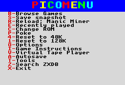
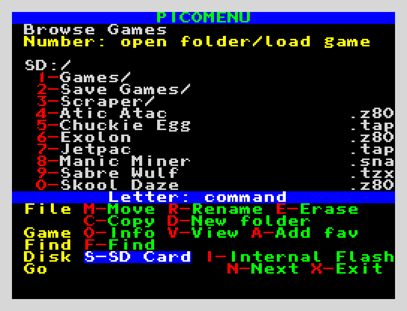
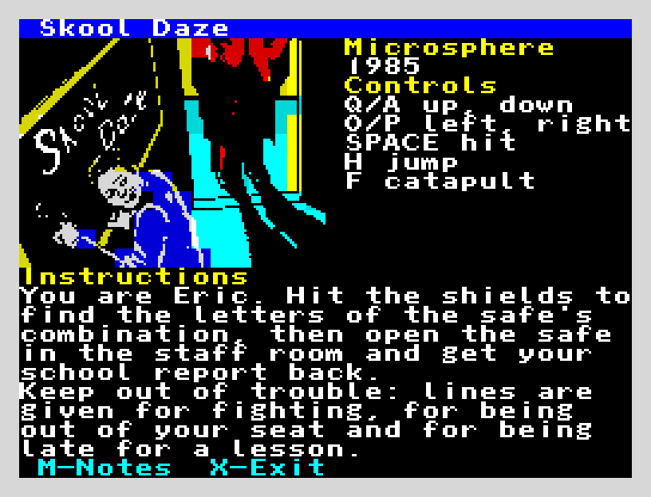

# Picomenu

Picomenu is a fork of [picoFace](https://github.com/) by Brian Apps: the hardware and the original firmware are his, and the menu and file features here are added on top. It keeps the GPL v3 licence (see `LICENSE` and `THIRD-PARTY-NOTICES.txt`). The picoFace is an inexpensive device for the ZX Spectrum that uses a Raspberry Pi Pico to provide Multiface style functionality.

Picomenu has been built using Brian Apps original code, an AI (Claude) has then developed on this with my input. My main input to this project was to decide on functionality, layout, feature set and testing.

Picomenu has been developed for and tested on a Spectrum +2 (Grey). It should work fine on a standard 48k or 128k model, although I have not been able to test. It will not work on +2A/+3, +2B, and +3B.

## User Guide

A full interactive user guide is provided in .pdf form. This guide includes full instructions on how to use Picomenu and links to YouTube videos outlining its main features. 

Picomenu can be used to:
* Replace the internal ROM with another image, optionally making it writable.
* Load and save snapshots, 48K and 128K, as `.sna`, `.z80` and `.szx`; load `.tap` and `.tzx` tapes.
* Convert a `.tap` or `.tzx` into a `.z80` snapshot.
* Provide a view screen where information about a game - publisher, release year, controls, instructions, etc for each game can be viewed.
* Take screen grabs in .scr or .png format.
* Transfer files between the Picoface and a PC when it is connected with a USB cable and the Spectrum is powered off (copy files without taking the card out; eject before unplugging).
* Transfer files between the Picoface and a PC using an online web browser (Pico W only).
* Browse the SD card and the internal flash.
* Save games, with dedicated save game slots
* Autosave (be can set to 20, 40 or 60 intervals).
* Apply pokes to loaded games, typed in or from a `.pok` file.
* Reset into 48K or 128K from the menu.
* Update PicoMenu's own firmware from a `.uf2` in the root of the SD card (T-Tools then U on the menu; if it fails, BOOTSEL still works).
* Fetch games, `.pok`  files and game information from ZXDB (Pico W only)
* Load `.tap` and `.tzx` files in realtime using Bluetooth (Pico W only and where you have a Bluetooth mod fitted to your Spectrum)

The NMI button (SW1):
| Press | Does |
|---|---|
| Short | Opens the NMI menu |
| Held 1 second (let go before 3 seconds) | **Save**: brings up the Save snapshot screen: where the game can be saved. Saving, or X/BREAK, takes you back to the game |
| Double press | **Screen grab**: takes a screen grab - this can be saved with the categories listed on the screen. Choosing a catagory or pressing BREAK takes you back to the game |
| Held 3 seconds | Resets into the Spectrum's own ROM |

## Related repositories

* The Picoface project is held in https://github.com/brianapps/picoface_poc
* The KiCad circuit design is held in https://github.com/brianapps/picoface_kicad

## Building the pico firmware

The firmware build relies on the following being installed and on the path (the Pico W build, `cmake -DWIFI_ENABLE=1`, also needs the Pico SDK's `lib/cyw43-driver`, `lib/lwip` and `lib/btstack` submodules: `git submodule update --init lib/cyw43-driver lib/lwip lib/btstack` in the SDK):

- [sjasmplus](https://github.com/z00m128/sjasmplus)
- Python 3.x
- Raspberry Pi Pico SDK 
- VSCode and VSCode Pico plugin.

## License

Picomenu is free software: you can redistribute it and/or modify it under the terms of
the GNU General Public License as published by the Free Software Foundation, either
version 3 of the License, or (at your option) any later version.

Picomenu is distributed in the hope that it will be useful, but WITHOUT ANY WARRANTY; 
without even the implied warranty of MERCHANTABILITY or FITNESS FOR A PARTICULAR PURPOSE.
See the GNU General Public License for more details.

A copy of the license is provided in the [LICENSE](./LICENSE) file.

### Additional permission (the Pico W firmware)

The copyright holders of picoFace (Brian Apps) and PicoMenu (Scott Ralph) add this permission to the GPL, as its section 7 allows (it is also at the top of [LICENSE](./LICENSE)):

> **Additional permission under GNU GPL version 3 section 7**
>
> If you modify Picoface or PicoMenu, or any covered work, by linking or combining it with the cyw43-driver (including the firmware of the CYW43439 wireless chip) or BTstack, as supplied by Raspberry Pi Ltd in the Raspberry Pi Pico SDK (or a modified version of those libraries), containing parts covered by the terms of Raspberry Pi Ltd's licences for them, the copyright holders of Picoface and PicoMenu grant you additional permission to convey the resulting work. Corresponding Source for a non-source form of such a combination need not include the source code of the cyw43-driver, the wireless chip's firmware or BTstack, which are available from Raspberry Pi Ltd in the Pico SDK.

So the Pico W firmware (`picomenu-...-W.uf2`), which has Raspberry Pi's cyw43 WiFi driver and BTstack (Bluetooth) in it, can be passed on as the standard one can, with LICENSE, THIRD-PARTY-NOTICES.txt and the source.

Third-party parts (FatFs, littlefs, LZ4, the Apache 2.0 SD driver, the Pico SDK, TinyUSB, the C runtime, and the Z80 emulator used by the tape converter, which is GNU LGPL v3) keep their own, GPL-compatible licences. The Pico W build also links lwIP (BSD), Raspberry Pi's cyw43 WiFi driver and BTstack (Bluetooth), whose licences allow them only with Raspberry Pi's chips (the Pico W, and BTstack for personal, non-commercial use) and are not GPL-compatible by themselves: the additional permission above lets the Pico W `.uf2` be passed on all the same. They are listed with their full texts in [THIRD-PARTY-NOTICES.txt](./THIRD-PARTY-NOTICES.txt); the Apache 2.0 text is in [pico/FatFs_SPI/LICENSE-Apache-2.0.txt](./pico/FatFs_SPI/LICENSE-Apache-2.0.txt).

## Acknowledgments

The picoface firmware includes the following libraries:

* [pico-littlefs](https://github.com/lurk101/pico-littlefs) by lurk101
* [no-OS-FatFS-SD-SDIO-SPI-RPi-Pico](https://github.com/carlk3/no-OS-FatFS-SD-SDIO-SPI-RPi-Pico) by Carl J Kugler III
* [lz4](https://github.com/lz4/lz4) by Yann Collet.
* [Z80](https://github.com/redcode/Z80) CPU emulator and [Zeta](https://github.com/redcode/Zeta) headers by Manuel Sainz de Baranda y Goñi (GNU LGPL v3), for the tape converter
* [Unscii](http://viznut.fi/unscii/) 8 font by Viznut (public domain / CC0), for the menu and the Pico's own screens

